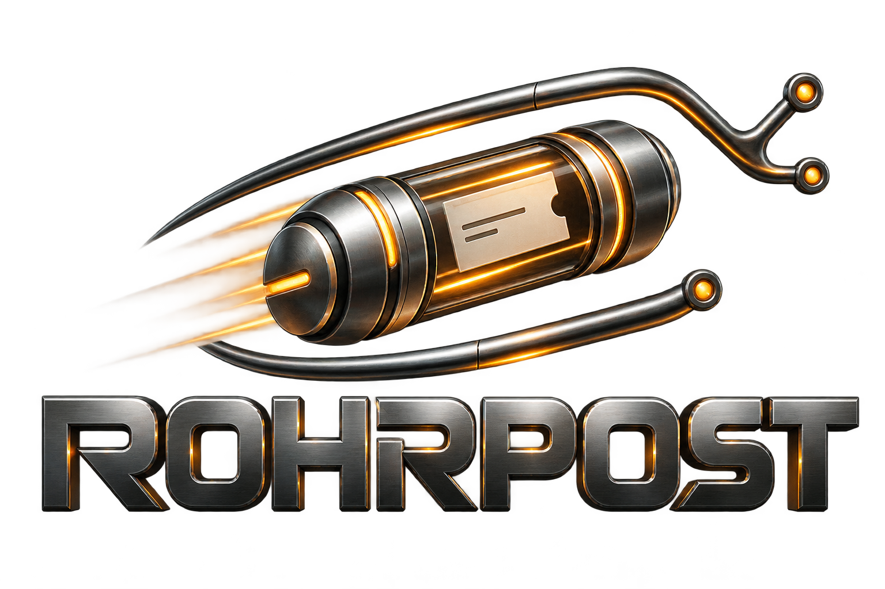

# Rohrpost



A ticket system for coding agents and the humans working with them. Tickets live
in your Git repository, alongside the code they describe.

[Project website](https://rohrpost.ventrion.dev) ·
[User guide](docs/users/README.md) ·
[Releases](https://github.com/ventrion/rohrpost/releases) ·
[Agent skill](.agents/skills/rohrpost/SKILL.md)

Rohrpost gives your project a shared work queue without a server or an account.
An agent can find an unblocked ticket, read its context, claim it, leave notes,
and close it from the terminal. A human can use the same commands to plan work,
review progress, or pick up where an agent left off.

The command is `rp`. It runs on Linux, macOS, and Windows, works offline, and is
written in Rust using only the standard library.

## Why keep tickets in Git?

The work plan travels with the checkout. Ticket changes can be committed with
the implementation, reviewed in a pull request, and shared through your usual
Git workflow. A fresh clone has the ticket history as well as the code.

Rohrpost provides:

- **A work queue that understands dependencies.** `rp ready` lists open tasks,
  bugs, and spikes whose blockers are done, ordered by priority.
- **Context for each ticket.** Bodies, labels, assignees, and comments keep the
  problem and the findings together.
- **Larger plans.** Group tickets into epics, and related epics into sagas.
  Parent status follows the work below it.
- **An interface for scripts and agents.** Every command supports `--json`;
  human-readable output is the default.
- **A recorded history.** Every change records an actor and timestamp in an
  append-only event log.

Rohrpost handles tickets and their history. Your existing tools still handle
code review, CI, and communication; `rp` itself makes no network requests.

## Install

Download the archive for your platform from the
[releases page](https://github.com/ventrion/rohrpost/releases), extract it, and put
`rp` on your `PATH` (`rp.exe` on Windows).

Release builds are available for Linux on x86_64 and ARM64, macOS on Intel and
Apple silicon, and Windows on x86_64. You do not need Rust to run them.

To build and install from source, use Rust 1.89 or newer:

```sh
cargo install --git https://github.com/ventrion/rohrpost --locked
```

Check the installation:

```sh
rp --version
```

## Your first ticket

Run these commands inside the Git repository where you want to track work:

```sh
rp init
rp new "Fix token refresh race" --type bug -p 1 --label auth \
  --body "Two requests can refresh the same token at once. Serialize the refresh."
rp ready
```

`rp init` creates `.rohrpost/` and adds Git merge and line-ending rules to
`.gitattributes`. Commit both so other checkouts share the tracker. Once it is
initialized, `rp` works from any directory inside the repository.

The new ticket gets an ID. Use that ID in the following commands, replacing
`<id>` with the value printed by `rp new`:

```sh
rp show <id>
rp claim <id>
rp comment <id> "Reproduced with two concurrent requests."
rp set <id> status=review
rp close <id> --reason "Serialized refresh; concurrency test passes."
```

You can use either the full displayed ID, such as `RP-a1b2c3`, or its bare form,
`a1b2c3`. Priorities run from `0` (highest) to `4` (lowest).

To make a ticket wait for another one:

```sh
rp new "Add refresh retry handling" --blocked-by <id>
```

It appears in `rp ready` once its blocker is done. Dropping a blocker does not
unblock the dependent ticket; remove the dependency if it no longer applies.

For longer descriptions, use `--body-file notes.md`. Templates, filtering,
epics, sagas, and the full ticket lifecycle are covered in the
[user guide](docs/users/README.md). Run `rp <command> --help` for command options.

## Working with agents

Agents use the same CLI with `--json`. A typical work loop is:

```sh
rp ready --limit 5 --json
rp show <id> --json
rp claim <id> --actor runner/my-agent --json
rp comment <id> "Found the cause in the refresh handler." --actor runner/my-agent --json
rp close <id> --reason "Fixed and verified." --actor runner/my-agent --json
```

Read the ticket before claiming it, record useful findings as you go, and close
it after verifying the work. `ready` and `list` omit ticket bodies; use `show`
to get the full context. Repeating a mutation that already matches the current
state succeeds without appending another event.

Use `--actor` to identify the agent, or set `ROHRPOST_RUNNER` and
`ROHRPOST_BATCH` in its environment. Without an override, Rohrpost uses the
human actor `user/<git email>`.

The repository includes an [agent skill](.agents/skills/rohrpost/SKILL.md) with
the work loop, ticket rules, and installation guidance. Add the
[skill directory](.agents/skills/rohrpost) to your agent's skills location and
follow its wrapper setup instructions. Agents contributing to Rohrpost itself
should instead use the working-tree build described below.

## How ticket history works

Changes are stored as JSON Lines in `.rohrpost/log.jsonl`. Each command reads
the events and reconstructs the current tickets. There is no database or cache
to synchronize, and archived events remain part of the history.

Events are deduplicated by ID and replayed in a deterministic order. Updates to
separate fields are preserved; competing scalar updates use the latest event
for that field. Git carries the history between checkouts when you commit,
push, pull, and merge.

Use `rp` to change tickets rather than editing the log by hand. If something
looks wrong, `rp doctor` checks integrity and `rp log <id>` shows the events
behind a ticket. The [architecture guide](docs/maintainers/architecture.md)
explains the storage and merge model in more detail.

## Contributing

Bug reports, documentation fixes, and code contributions are welcome. This
project tracks its own work in Rohrpost. Start by reading
[AGENTS.md](AGENTS.md) and the [tracker conventions](docs/agents/issue-tracker.md).
For a substantial change, record a ticket describing the problem and proposed
approach before starting the implementation.

Use the code in your checkout to inspect and update this repository's tickets:

```sh
cargo run -q -- ready --json
cargo run -q -- list --status open --json
cargo run -q -- show <id> --json
```

To record a bug, include reproduction steps, expected behavior, actual behavior,
and your platform. For example, save those details in `report.md`, then run:

```sh
cargo run -q -- new "Describe the bug" --type bug --label needs-triage \
  --body-file report.md --json
```

Include the ticket changes with your contribution and open a pull request.
Keep changes focused, update affected documentation, and add tests that verify
meaningful behavior. The crate intentionally has no dependencies, and changes
must work on Linux, macOS, and Windows.

Run the checks before submitting:

```sh
cargo fmt --check
cargo clippy --all-targets --locked -- -D warnings
cargo test --locked
```

`make check` runs the format, lint, and test checks too. CI also tests all three
platforms and checks the minimum supported Rust version.

For more context, see the [architecture](docs/maintainers/architecture.md),
[domain terminology](CONTEXT.md), [design decisions](docs/adr/), and
[behavioral specification](docs/spec/ROHRPOST-SPEC.md).

## License

Rohrpost is available under the [MIT license](LICENSE). Copyright © 2026 ventrion.
